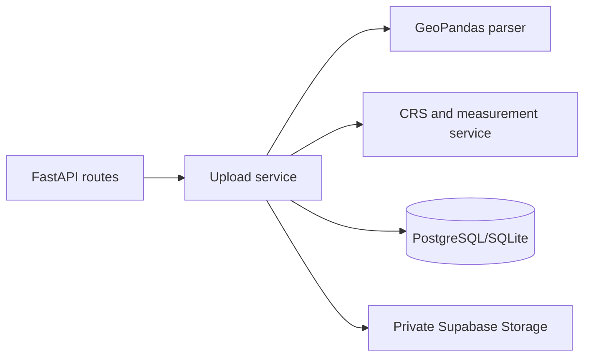

# Geospatial File Measurement API

FastAPI backend for uploading KML or a ZIP containing one Shapefile dataset, preserving GeoJSON geometry and properties, and measuring supported features in metres or square metres.

## Quick start

Python 3.12+ is recommended. Create a virtual environment, install dependencies, copy `.env.example` to `.env`, and configure `DATABASE_URL` plus the server-only Supabase values. For a local smoke test the default SQLite URL works and storage is written to `.storage`; production should use Supabase PostgreSQL and a private Storage bucket.

```powershell
python -m venv .venv
.\.venv\Scripts\Activate.ps1
pip install -r requirements.txt
alembic upgrade head
uvicorn app.main:app --reload
pytest
```

Run `alembic upgrade head` before starting the application. The application does not create production tables automatically; schema changes are managed by Alembic.

If a previous local run created `geospatial.db` before migrations were applied, stop the server and remove that local database, then run the migration again:

```powershell
Remove-Item .\geospatial.db
alembic upgrade head
```

Only do this for the disposable local SQLite database. Never delete a production database.

## Railway deployment with Docker

The repository includes a root `Dockerfile`, `.dockerignore`, and `railway.toml`. Railway detects the Dockerfile, runs `alembic upgrade head` as a pre-deploy command, and checks `/health` before activating a deployment. Railway injects `PORT`; the container listens on it automatically.

1. Push this repository to GitHub and create a Railway project from the repository.
2. Add the variables below in the Railway service. Do not commit real secret values.
3. Deploy. Generate a Railway public domain under the service Networking settings.

Required Railway variables:

```text
DATABASE_URL=postgresql+psycopg://...
SUPABASE_URL=https://your-project.supabase.co
SUPABASE_SECRET_KEY=your-server-only-secret-key
SUPABASE_STORAGE_BUCKET=geospatial-uploads
MAX_UPLOAD_SIZE_BYTES=52428800
```

Use a Supabase PostgreSQL connection string that is reachable from Railway. Supabase Storage remains the upload store; the local `.storage` fallback is for development only. Railway's pre-deploy migration command requires the database to be reachable and the database user to have schema migration permissions.

After deployment, verify `https://YOUR-RAILWAY-DOMAIN/health` and open `https://YOUR-RAILWAY-DOMAIN/docs` for Swagger UI. Railway's Dockerfile detection and `PORT`/healthcheck behavior are documented in the [Railway Dockerfile guide](https://docs.railway.com/builds/dockerfiles) and [healthcheck guide](https://docs.railway.com/deployments/healthchecks).

## Frontend development

The Next.js frontend lives in `frontend/` and uses the verified FastAPI routes; it does not duplicate parsing, storage, CRS, or measurement logic.

```powershell
cd frontend
Copy-Item .env.example .env.local
npm install
npm run dev
```

Set `NEXT_PUBLIC_API_BASE_URL` in `frontend/.env.local` to the running FastAPI URL, normally `http://127.0.0.1:8000`. Start the backend in another terminal with `uvicorn app.main:app --reload`, then open `http://localhost:3000`. The workspace uploads through `POST /api/files/`; the details page reads `GET /api/files/{id}/` and the paginated measurements endpoint. `FRONTEND_ORIGINS=http://localhost:3000` must be set in the backend environment for browser requests. For a deployed frontend, use a comma-separated list of trusted origins.

Frontend checks:

```powershell
cd frontend
npm run build
```

Create a Supabase project, copy its PostgreSQL connection string into `DATABASE_URL` (use the pooled connection for serverless/high-concurrency deployments), create a private bucket named by `SUPABASE_STORAGE_BUCKET`, and use the secret/server key only in the backend environment. Run `alembic upgrade head` against that database.

## API

* `POST /api/files/` — multipart field `file`; accepts `.kml` and `.zip`; returns HTTP 201 metadata.
* `GET /api/files/{id}/` — metadata and processing status.
* `GET /api/files/{id}/measurements/?page=1&page_size=100` — paginated features, original GeoJSON, properties, CRS, and a measurement object.
* `GET /health` and `/docs` are available for operational checks and OpenAPI documentation.

KML is interpreted as EPSG:4326 by the KML driver. Shapefile CRS must be present and usable. Geographic data is transformed to an estimated UTM CRS where possible; area and length are never calculated in degrees. Polygon/MultiPolygon produce `area/m²`, LineString/MultiLineString produce `length/m`, and point features return `not_required`. Invalid and unsupported geometries become feature-level measurement errors and do not abort other features.

## Architecture and safety



The application validates extension, size, archive paths, Shapefile components, CRS, and geometry status. ZIP extraction rejects absolute paths, `..` traversal, multiple `.shp` datasets, and missing `.shx`/`.dbf`. Upload processing is synchronous for this assignment. Authentication, rate limiting, and asynchronous jobs are intentionally future scope. Supabase integration and real-database integration tests require a user-provided environment and are not claimed as live-verified here.

## Design decisions and future scope

JSON/JSONB is used for geometry and properties so PostGIS is not required. Original geometries are never overwritten and invalid geometries are never silently repaired. Future improvements include background processing, authentication, rate limiting, object cleanup compensation, richer projection selection for cross-zone datasets, and integration tests against an isolated Supabase project.
# Measurement workspace extensions

The file details workspace now includes:

- an interactive MapLibre GL JS view using `@vis.gl/react-maplibre`, with polygon, line, and point GeoJSON layers, selection highlighting, fit/zoom/pan controls, scale, attribution, and a geometry-only fallback when the configured basemap is unavailable;
- whole-dataset measurement analytics with area in m²/hectares/acres and length in metres/kilometres;
- synchronized feature-table/map selection and an inspector for original GeoJSON, properties, CRS and status;
- complete CSV export at `GET /api/files/{file_id}/export.csv`;
- summary data at `GET /api/files/{file_id}/summary/` and feature diagnostics at `GET /api/files/{file_id}/diagnostics/`.
- a complete CSV report action with progress and network-error feedback; the backend export includes all features, including failed, unsupported, and not-required records.
- categorized diagnostics for validation, CRS, measurement, and unsupported-geometry conditions, with source and measurement CRS context where available.

The authoritative area and length calculations remain in FastAPI. Original geometries are stored unchanged; display geometries are transformed to EPSG:4326 only for map rendering. The map intentionally does not depend on third-party tiles, so it remains useful in offline or restricted environments; it provides pan, zoom, fit, and selection controls and shows a clear empty state when a source CRS cannot be converted. Projected measurement CRSs are accepted only when their axis units are metric; geographic CRSs are converted to an estimated projected CRS before measurement.

The frontend map uses `NEXT_PUBLIC_MAP_STYLE_URL`, defaulting in development to MapLibre's public demo style (`https://demotiles.maplibre.org/style.json`). Configure a production MapLibre-compatible style from a tile provider you have permission to use, and review that provider's attribution and usage limits. MapLibre's own stylesheet is bundled locally; no map-provider secret is exposed to the browser.
