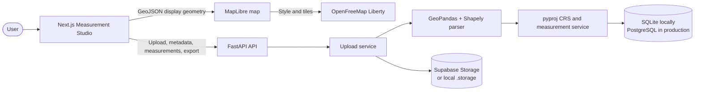

# Geo Studio

<p align="center">
  <a href="https://geo-spatial-hub-seven.vercel.app/">
    
  </a>
</p>

<p align="center">
  <a href="https://geo-spatial-hub-seven.vercel.app/">
    
  </a>
  <a href="https://aereo-geo-spatial-api-production.up.railway.app/">
    
  </a>
  <a href="https://aereo-geo-spatial-api-production.up.railway.app/docs">
    
  </a>
</p>

Upload a KML file or a ZIP archive containing one Shapefile dataset, inspect its CRS and properties, and review backend-verified area and length measurements on an interactive map.

The FastAPI backend is authoritative for parsing, CRS conversion, measurement, storage, and validation. The Next.js workspace presents those verified results without reimplementing geospatial processing in the browser.

## Tech stack

| Layer | Technology |
| --- | --- |
| API | [](https://fastapi.tiangolo.com/) |
| Runtime | [](https://www.python.org/) [](https://www.uvicorn.org/) |
| Geospatial processing | [](https://geopandas.org/) [](https://shapely.readthedocs.io/) [](https://pyproj4.github.io/pyproj/stable/) |
| Database and migrations | [](https://www.sqlalchemy.org/) [](https://alembic.sqlalchemy.org/) [](https://www.postgresql.org/) |
| Frontend | [](https://nextjs.org/) [](https://react.dev/) [](https://www.typescriptlang.org/) |
| Mapping | [](https://maplibre.org/) [](https://openfreemap.org/) |
| Delivery and storage | [](https://www.docker.com/) [](https://railway.app/) [](https://supabase.com/) |

## Interactive architecture

The browser owns presentation and interaction. FastAPI owns all trusted geospatial work, while storage and the database remain behind the API boundary.



### Request flow

1. The user uploads KML or ZIP Shapefile data in the Next.js workspace.
2. FastAPI validates the file, archive contents, CRS, and geometry records.
3. GeoPandas and Shapely parse the source geometry; pyproj creates display and measurement copies.
4. Original geometry and properties are stored unchanged. Measurements are calculated in metric projected CRS where required.
5. The details page requests verified JSON, renders display geometry in MapLibre, and synchronizes map selection with the feature table and inspector.

## Run locally

Requirements: Python 3.12+, Node.js 20+, npm, and PowerShell or an equivalent shell.

### 1. Start the API

From the repository root:

```powershell
python -m venv .venv
.\.venv\Scripts\Activate.ps1
pip install -r requirements.txt
Copy-Item .env.example .env
alembic upgrade head
uvicorn app.main:app --reload --port 8000
```

The API is available at `http://127.0.0.1:8000`.

Verify it before opening the frontend:

```powershell
Invoke-WebRequest http://127.0.0.1:8000/health
```

Expected response:

```json
{"status":"ok"}
```

For a second local API instance, use another port such as `8001`. The frontend can try ports 8000 and 8001 when `NEXT_PUBLIC_API_BASE_URL` is not set.

### 2. Start the frontend

Open a second terminal from the repository root:

```powershell
cd frontend
Copy-Item .env.example .env.local
npm install
npm run dev -- --port 3000
```

Open `http://localhost:3000`. If port 3000 is occupied, run `npm run dev -- --port 3001` and add that origin to the backend `FRONTEND_ORIGINS` setting.

The tracked frontend environment template uses:

```env
NEXT_PUBLIC_API_BASE_URL=http://127.0.0.1:8000
NEXT_PUBLIC_MAP_STYLE_URL=https://tiles.openfreemap.org/styles/liberty
```

Restart Next.js after changing `NEXT_PUBLIC_*` values. The map worker is served locally from `frontend/public/maplibre-gl-worker.mjs`.

### 3. Run checks

Backend tests:

```powershell
pytest
```

Frontend checks:

```powershell
cd frontend
npm run lint
npm run build
```

## API endpoints

| Method | Endpoint | Purpose |
| --- | --- | --- |
| `GET` | `/health` | Runtime health check |
| `POST` | `/api/files/` | Upload KML or ZIP Shapefile |
| `GET` | `/api/files/{id}/` | File metadata and status |
| `GET` | `/api/files/{id}/measurements/` | Paginated feature measurements and GeoJSON |
| `GET` | `/api/files/{id}/summary/` | Aggregate area, length, status, and CRS summary |
| `GET` | `/api/files/{id}/diagnostics/` | Failed and unsupported feature diagnostics |
| `GET` | `/api/files/{id}/export.csv` | Complete CSV measurement report |
| `GET` | `/docs` | FastAPI Swagger UI |

KML is interpreted as EPSG:4326. Shapefiles must include a usable CRS. Polygon and MultiPolygon features produce area measurements, LineString and MultiLineString features produce length measurements, and Point/MultiPoint features are returned as `not_required` while remaining visible on the map.

## Configuration

Backend settings are loaded from the root `.env` file. Frontend settings are loaded from `frontend/.env.local`; do not commit that file.

```env
DATABASE_URL=sqlite+pysqlite:///./geospatial.db
FRONTEND_ORIGINS=http://localhost:3000,http://localhost:3001,https://geo-spatial-hub-seven.vercel.app
MAX_UPLOAD_SIZE_BYTES=52428800
```

For production, use PostgreSQL and a private Supabase Storage bucket. Do not commit database passwords, Supabase secret keys, or other credentials.

## Deployment

The repository includes `Dockerfile`, `.dockerignore`, and `railway.toml` for Railway deployment. Railway runs the Alembic migration as a pre-deploy command, injects `PORT`, and checks `/health` before activation.

Live deployments:

- [Live Frontend](https://geo-spatial-hub-seven.vercel.app/)
- [Live API](https://aereo-geo-spatial-api-production.up.railway.app/)
- [API Docs](https://aereo-geo-spatial-api-production.up.railway.app/docs)

Required production variables include:

```text
DATABASE_URL=postgresql+psycopg://...
SUPABASE_URL=https://your-project.supabase.co
SUPABASE_SECRET_KEY=your-server-only-secret-key
SUPABASE_STORAGE_BUCKET=geospatial-uploads
MAX_UPLOAD_SIZE_BYTES=52428800
```

For the Vercel frontend, set:

```text
NEXT_PUBLIC_API_BASE_URL=https://aereo-geo-spatial-api-production.up.railway.app
```

Original geometry is never silently overwritten or repaired. ZIP extraction rejects absolute paths, traversal paths, multiple Shapefile datasets, and missing `.shx`/`.dbf` components. Authentication, rate limiting, and asynchronous processing remain future scope.
