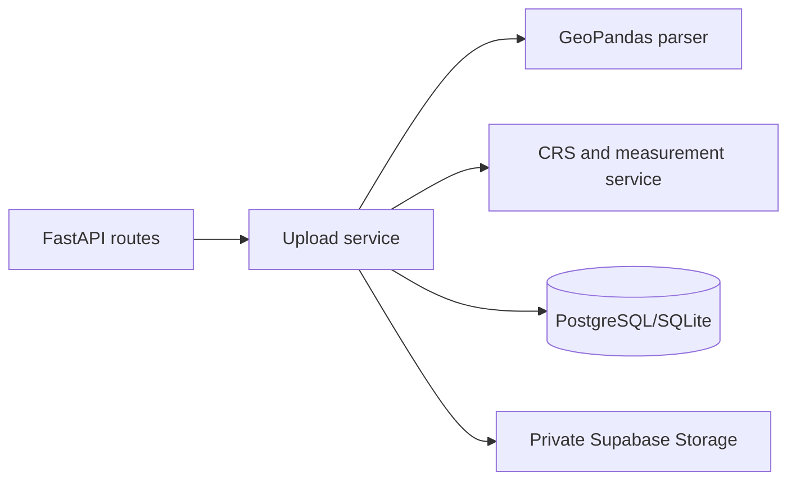

# Geospatial File Measurement API

FastAPI backend for uploading KML or a ZIP containing one Shapefile dataset, preserving GeoJSON geometry and properties, and measuring supported features in metres or square metres.

## Quick start

Python 3.12+ is recommended. Create a virtual environment, install dependencies, copy `.env.example` to `.env`, and configure `DATABASE_URL` plus the server-only Supabase values. For a local smoke test the default SQLite URL works and storage is written to `.storage`; production should use Supabase PostgreSQL and a private Storage bucket.

```powershell
python -m venv .venv
.\.venv\Scripts\Activate.ps1
pip install -r requirements.txt
alembic upgrade head
uvicorn app.main:app --reload
pytest
```

## Railway deployment with Docker

The repository includes a root `Dockerfile`, `.dockerignore`, and `railway.toml`. Railway detects the Dockerfile, runs `alembic upgrade head` as a pre-deploy command, and checks `/health` before activating a deployment. Railway injects `PORT`; the container listens on it automatically.

1. Push this repository to GitHub and create a Railway project from the repository.
2. Add the variables below in the Railway service. Do not commit real secret values.
3. Deploy. Generate a Railway public domain under the service Networking settings.

Required Railway variables:

```text
DATABASE_URL=postgresql+psycopg://...
SUPABASE_URL=https://your-project.supabase.co
SUPABASE_SECRET_KEY=your-server-only-secret-key
SUPABASE_STORAGE_BUCKET=geospatial-uploads
MAX_UPLOAD_SIZE_BYTES=52428800
```

Use a Supabase PostgreSQL connection string that is reachable from Railway. Supabase Storage remains the upload store; the local `.storage` fallback is for development only. Railway's pre-deploy migration command requires the database to be reachable and the database user to have schema migration permissions.

After deployment, verify `https://YOUR-RAILWAY-DOMAIN/health` and open `https://YOUR-RAILWAY-DOMAIN/docs` for Swagger UI. Railway's Dockerfile detection and `PORT`/healthcheck behavior are documented in the [Railway Dockerfile guide](https://docs.railway.com/builds/dockerfiles) and [healthcheck guide](https://docs.railway.com/deployments/healthchecks).

Create a Supabase project, copy its PostgreSQL connection string into `DATABASE_URL` (use the pooled connection for serverless/high-concurrency deployments), create a private bucket named by `SUPABASE_STORAGE_BUCKET`, and use the secret/server key only in the backend environment. Run `alembic upgrade head` against that database.

## API

* `POST /api/files/` — multipart field `file`; accepts `.kml` and `.zip`; returns HTTP 201 metadata.
* `GET /api/files/{id}/` — metadata and processing status.
* `GET /api/files/{id}/measurements/?page=1&page_size=100` — paginated features, original GeoJSON, properties, CRS, and a measurement object.
* `GET /health` and `/docs` are available for operational checks and OpenAPI documentation.

KML is interpreted as EPSG:4326 by the KML driver. Shapefile CRS must be present and usable. Geographic data is transformed to an estimated UTM CRS where possible; area and length are never calculated in degrees. Polygon/MultiPolygon produce `area/m²`, LineString/MultiLineString produce `length/m`, and point features return `not_required`. Invalid and unsupported geometries become feature-level measurement errors and do not abort other features.

## Architecture and safety



The application validates extension, size, archive paths, Shapefile components, CRS, and geometry status. ZIP extraction rejects absolute paths, `..` traversal, multiple `.shp` datasets, and missing `.shx`/`.dbf`. Upload processing is synchronous for this assignment. Authentication, rate limiting, and asynchronous jobs are intentionally future scope. Supabase integration and real-database integration tests require a user-provided environment and are not claimed as live-verified here.

## Design decisions and future scope

JSON/JSONB is used for geometry and properties so PostGIS is not required. Original geometries are never overwritten and invalid geometries are never silently repaired. Future improvements include background processing, authentication, rate limiting, object cleanup compensation, richer projection selection for cross-zone datasets, and integration tests against an isolated Supabase project.
